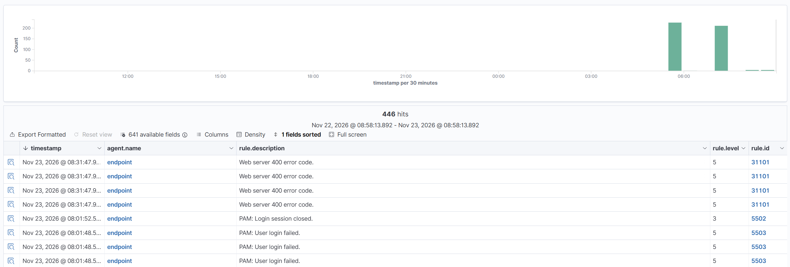
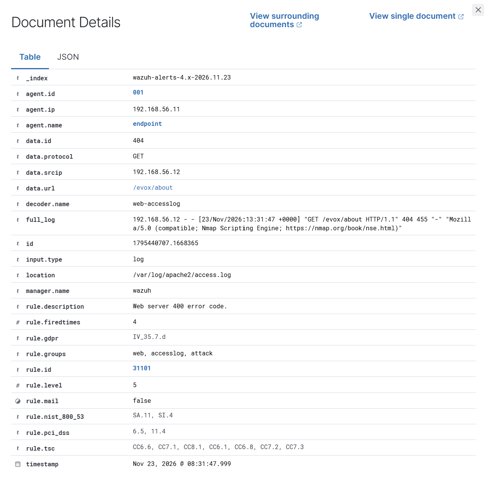
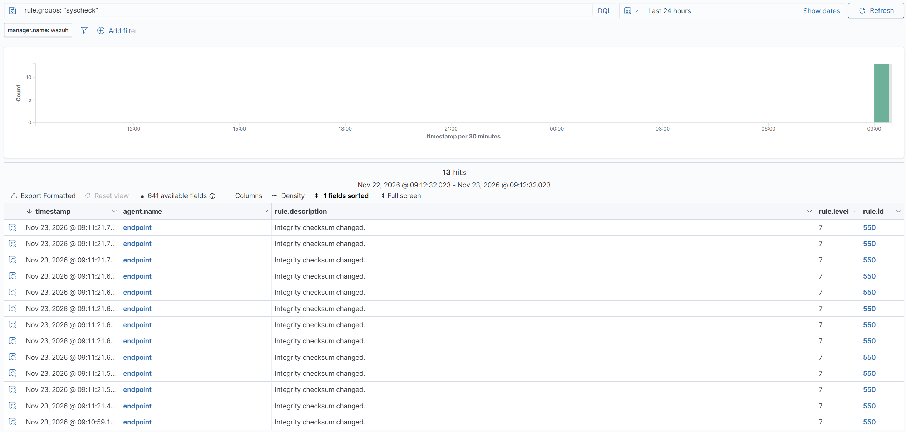

# Exercise 2: Port Scan And File Integrity Monitoring

**MITRE ATT&CK:** T1046 (Network Service Discovery), T1565 (Data Manipulation)

## Part A: Port Scan

From Kali:

```
bash
nmap -sS -sV 192.168.56.11
```

This found two open ports (22/SSH, 80/HTTP) and fingerprinted their service versions.

**What I Found**

The SYN scan (`-sS`) produced no alerts at all — one connection attempt per port doesn't match Wazuh's baseline rules since there's no log entry to react to. But the `-sV` service detection probes did leave a trace: Apache logged several nmap version probe requests as **400 Bad Request** errors, and Wazuh's own ruleset marked that pattern as an attack, not an error.

The expanded document showed:
- `data.srcip: 192.168.56.12` — Kali's IP
- `full_log` Contained `Mozilla/5.0 (compatible; Nmap Scripting Engine; ...)` — nmap's Probe
- `data.url: /evox/about` — nmap's Built In Probe Path




## Part B: File Integrity Monitoring (FIM)

From endpoint:

```
bash
sudo useradd -m testuser2
echo "<h1>defaced</h1>" | sudo tee /var/www/html/index.html
```

**What Actually Happened:**

This produced no alerts on my initial attempt due to two separate
reasons:

1. **`/var/www/html` Isn't Watched Automatically** Wazuh's FIM only watches
   system directories like `/etc`, `/bin`, and `/sbin` — not the web root. This was added
   manually to `ossec.conf`:

   ```
   xml
   <directories realtime="yes">/var/www/html</directories>
   ```

2. **The First FIM Scan Is Baseline, Not A Detector.** My initial `/etc/passwd` modification  
   happened before syscheck's scan on this agent, so it was
   absorbed into the baseline and did not produce an alert. Only updates made once a baseline
   already exists are marked.

I also shortened the scan interval from 12 hours (`43200` seconds) to 2 minutes (`120`
seconds). This is purely a lab convenience.

Once I fixed both issues and redid the defacement, Wazuh picked it up almost instantly:



Thirteen alerts fired within the same second on a one file write — likely
because syscheck marks several attributes on one update (hash, size, permissions, mtime) as
separate events. It is worth to tune this down in a real deployment to avoid alert fatigue.