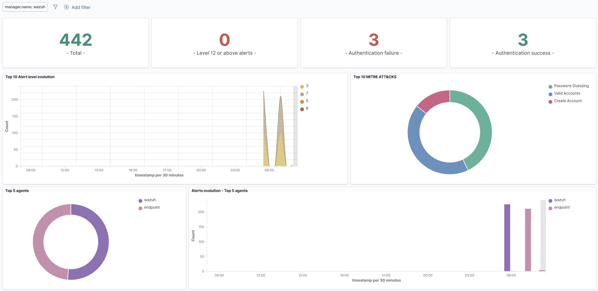
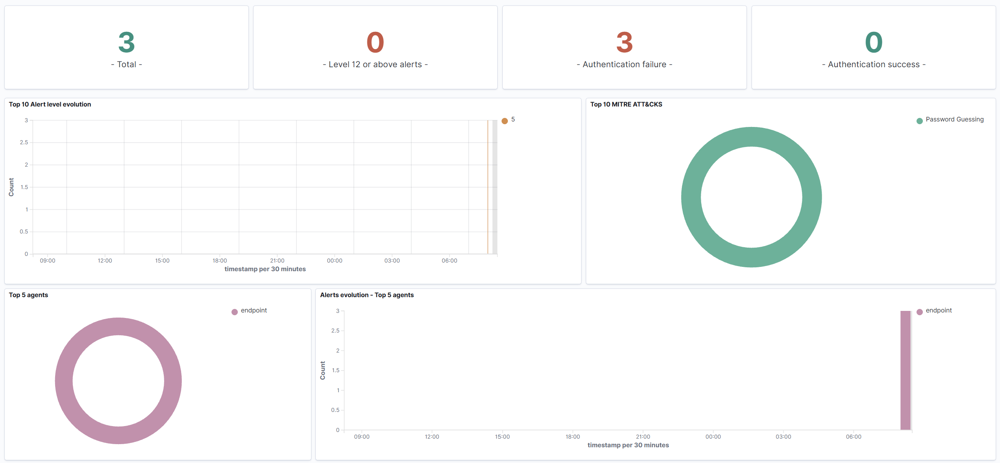

# Exercise 1: SSH Brute-Force Detection

**Goal:** Generate A Brute-Force Attack And Confirm The SIEM Detects It.
**MITRE ATT&CK:** T1110 (Brute Force)

## Steps

1. Start the lab with `vagrant up wazuh endpoint kali`.
2. Make sure your endpoint shows **Active** in the Wazuh dashboard.
3. On Kali (`vagrant ssh kali`), build a small wordlist and attack the endpoint's SSH service:

   ```
   bash
   printf "123456\nletmein\npassword123\nadmin\n" > words.txt
   hydra -l labuser -P words.txt ssh://192.168.56.11
   ```
   
4. In the dashboard, open **Explore > Discover** and search `rule.groups: "authentication_failed"`.

## What I Found

- Hydra's wordlist attempts were marked as **Password Guessing** under MITRE ATT&CK T1110.
- The successful login that was marked separately as **Valid Accounts** (T1078).
- The run produced 3 authentication failure alerts and 3 authentication success alerts.
- Every alert's `agent.name` was `endpoint`, since that's where the Wazuh agent lives and reads
  the SSH records.


